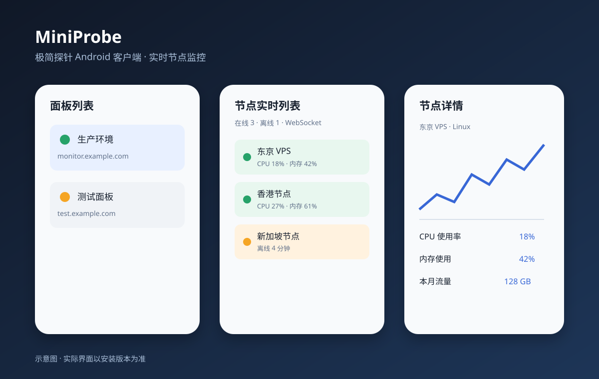

# MiniProbe：极简探针 Android 客户端

[monitor-probe/monitor](https://github.com/monitor-probe/monitor)（极简探针）的第三方 Android 客户端。

基于 [icylian/Yanami](https://github.com/icylian/Yanami) 的架构（MVI + Voyager + Koin + Ktor + Room + Compose），
针对极简探针的 API 重新实现，并修复了原项目代码审查中发现的问题。

## 功能

- **多面板管理**：保存多个探针面板，支持管理员密码（应急密码）与访客模式（公开页）
- **节点实时列表**：WebSocket 推送（服务端每 2 秒全量帧），兼容数组及 `{nodes:[...]}` 包装响应，搜索、分组筛选、在线/离线筛选、排序，下拉刷新
- **节点详情**：实时指标（CPU/内存/磁盘/网络/负载/运行时间）、流量统计（本月/累计/今日）、到期提醒、系统信息
- **历史图表**：CPU / 内存 / 磁盘 / 网络曲线（1h / 6h / 24h / 7d，窗口上限跟随服务端 retention）
- **设置**：主题色、深浅色、语言（中/英）、字体缩放、图表动画、生物识别锁、配置备份导出/导入、检查更新

## App 预览



> 图片为功能示意图，展示面板列表、实时节点和节点详情三个核心页面。

## 极简探针 API 适配

| 功能 | 接口 |
|---|---|
| 登录 | `POST /api/auth/login` `{"password": "..."}` → `Set-Cookie: monitor_session=...`（14 天） |
| 会话校验 | `GET /api/me` → `{"authed": true, "site_name": ..., "history_days": ...}` |
| 登出 | `POST /api/auth/logout` |
| 节点列表 | `GET /api/nodes`（兼容数组及 `{nodes:[...]}` 响应） |
| 实时推送 | `GET /api/ws` WebSocket，服务端每 2 秒推送完整节点数组或包装对象 |
| 历史指标 | `GET /api/nodes/{id}/metrics?hours=&points=&series=metrics` |

访客模式：面板开启公开页时，无需密码即可查看公开节点。

## 相对原项目的安全修复

1. **Session 拦截器 host 校验**：只在请求 host 与当前面板 host 一致时注入 cookie，且跳过 `/api/auth/login`，
   修复测试新面板时把旧面板 session 发给新面板的问题
2. **备份导出明文警告**：导出前弹窗明确告知文件包含明文密码；session 不再导出
3. **生物识别锁 fail-closed**：启用后若设备生物识别不可用，显示锁定页而非静默放行
4. **FLAG_SECURE**：禁止截屏/录屏
5. **自动备份排除数据库**：`backup_rules.xml` / `data_extraction_rules.xml` 排除 Room 数据库
   （KeyStore 密钥不随备份迁移，备份数据库只会留下无法解密的数据）
6. **网络日志**：release 包完全关闭；debug 包只记 HEADERS 且脱敏 Cookie/Set-Cookie（登录 body 含明文密码）
7. **Koin 日志**：只在 debug 包输出

## 构建

```bash
# 需要 Android SDK（API 36）与 JDK 17
./gradlew assembleDebug
```

Release 签名通过环境变量配置（见 `.github/workflows/release.yml`）：
`KEYSTORE_FILE` / `KEYSTORE_PASSWORD` / `KEY_ALIAS` / `KEY_PASSWORD`。

打 tag（如 `v1.0.0`）推送后，GitHub Actions 自动构建签名 APK。
注意：`UpdateCheckService.UPDATE_URL` 与 `update.json` 中的仓库地址请替换为你自己的。

## 截图

## 快速开始

1. 在 Android Studio 中打开 `minimal-probe-android`。
2. 使用 JDK 17、Gradle 9.3.1 和 Android SDK 36。
3. 执行：

```bash
./gradlew assembleDebug
```

生成的 APK 位于 `app/build/outputs/apk/debug/`。

也可以直接从 [Releases](https://github.com/bobvhfhh/minimal-probe-android/releases) 下载 APK。

## 连接面板

- 地址填写面板根地址，例如 `https://monitor.example.com`。
- 密码模式使用极简探针管理员密码。
- 访客模式要求服务端开启公开页。
- HTTP 面板可以使用 `http://`，生产环境建议使用 HTTPS。

## 适配说明

当前客户端实现了以下极简探针接口：

- `POST /api/auth/login`
- `GET /api/me`
- `POST /api/auth/logout`
- `GET /api/nodes`
- `GET /api/nodes/{id}/metrics`
- `GET /api/ws`

节点响应兼容直接数组、`{ "nodes": [...] }` 和 `data` 包装格式；实时连接会根据面板地址自动选择 `ws` 或 `wss`。

## 安全说明

- 密码和 session 使用 Android KeyStore + AES-GCM 加密保存。
- session 仅注入到匹配协议、主机和端口的面板请求。
- Release 日志关闭，应用启用 `FLAG_SECURE` 防止截屏和录屏。
- 配置导出为明文 JSON，导出前请妥善保管文件。

## 发布构建

Release 签名通过以下环境变量配置：

```text
KEYSTORE_FILE
KEYSTORE_PASSWORD
KEY_ALIAS
KEY_PASSWORD
```

不要把 keystore、密码、session 或真实面板地址提交到仓库。

## 致谢

- [monitor-probe/monitor](https://github.com/monitor-probe/monitor)
- [icylian/Yanami](https://github.com/icylian/Yanami)
